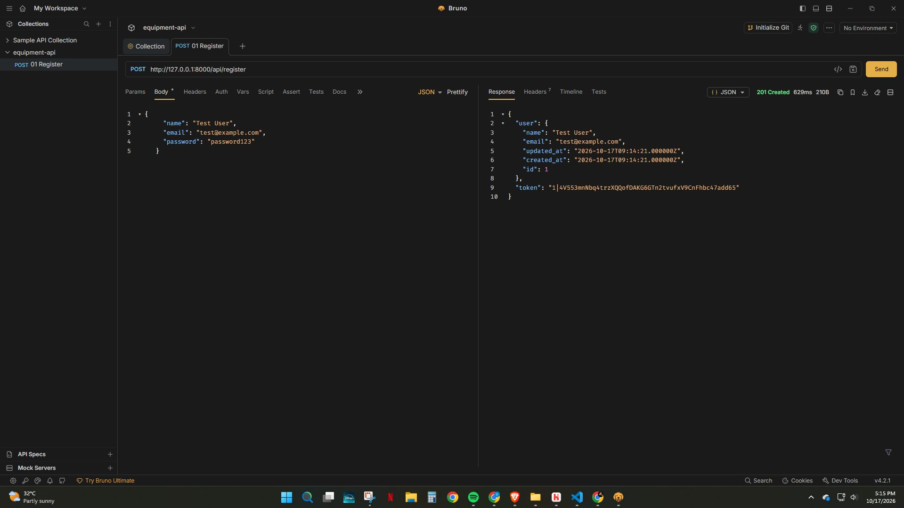
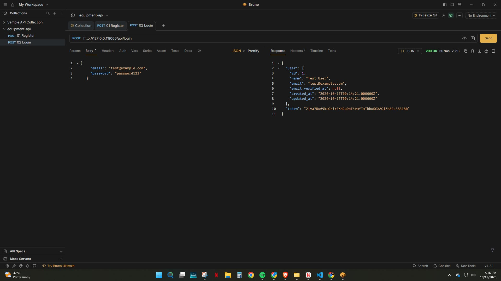
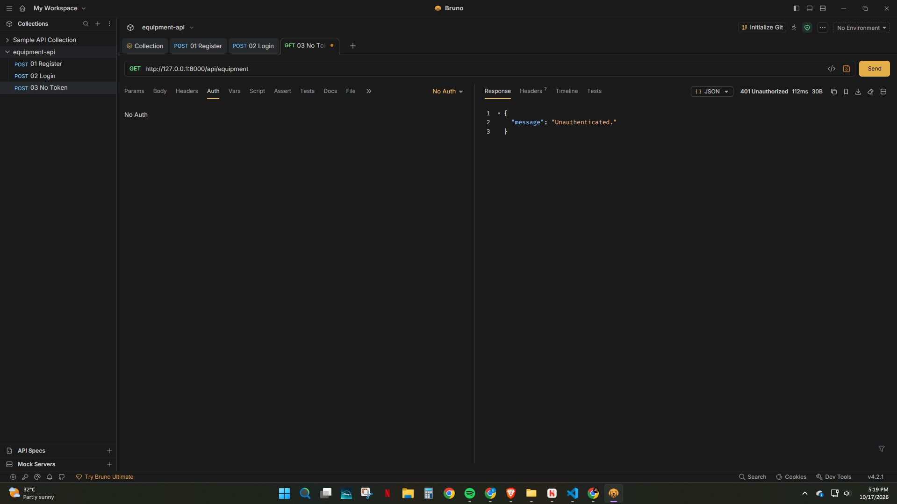
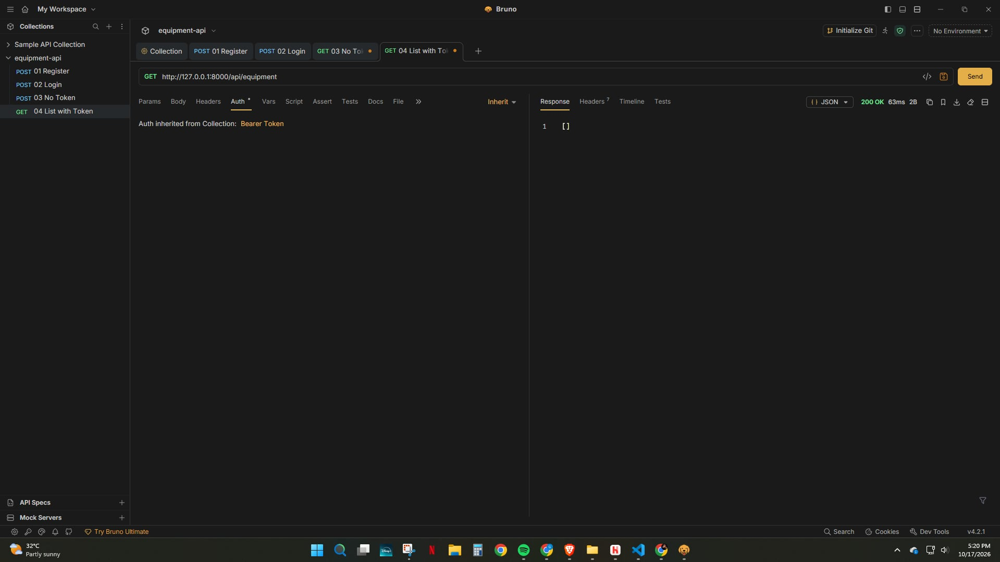
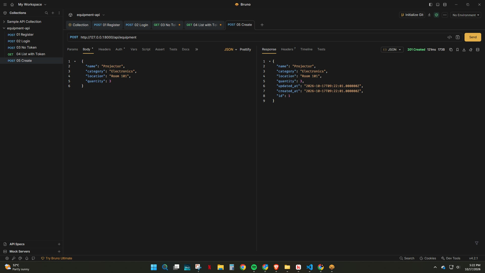
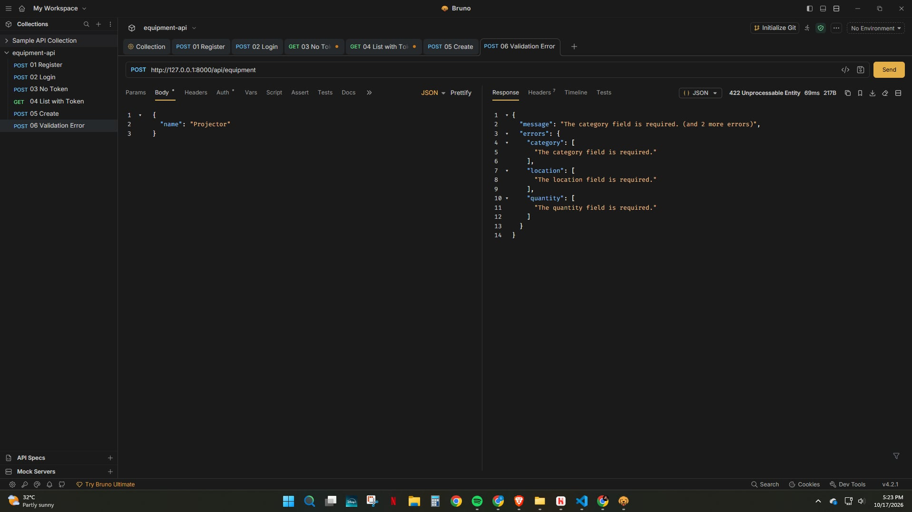
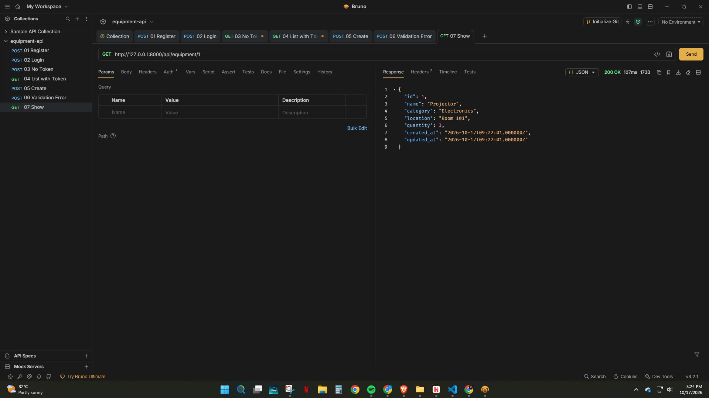
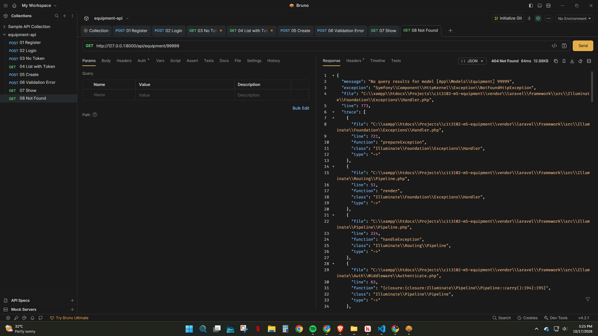
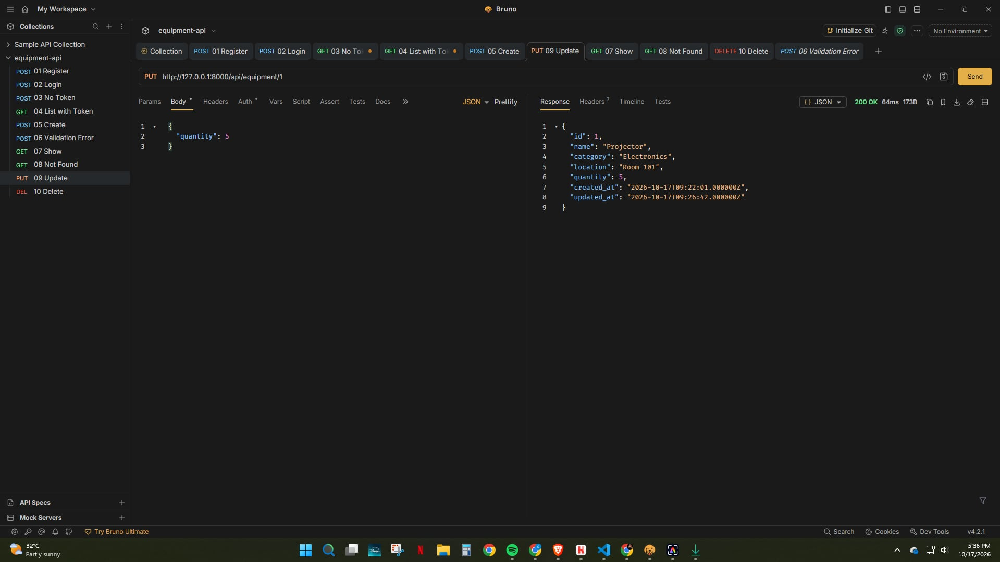
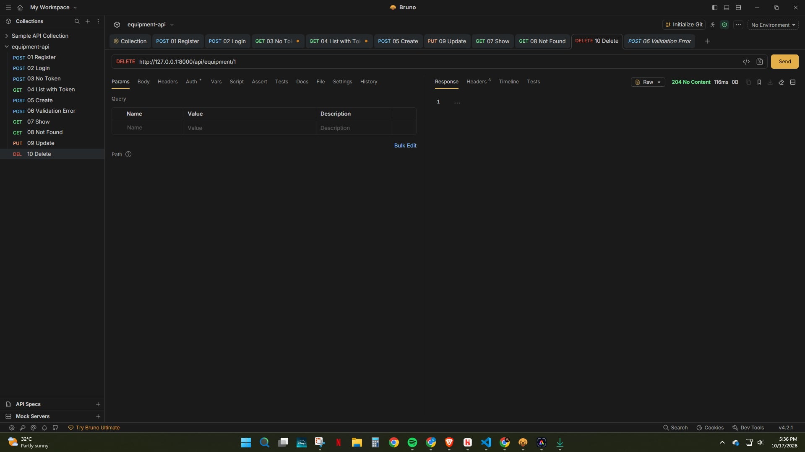

# Equipment API

**Course / Section:** CIT3102 – IT3E

**Partners:** Gian Ronald V. Tarcena, Eijay Iverson D. Villanueva

**Resource:** Equipment (`name`, `category`, `location`, `quantity`)

A REST API built with Laravel and Sanctum. Equipment records can be created, listed, filtered, updated, and deleted by logged-in users.

## Setup

Requires PHP 8.4+ and Composer.

```bash
git clone https://github.com/tarcenagianronald-lang/cit3102-m5-equipment.git
cd cit3102-m5-equipment
composer install
cp .env.example .env
php artisan key:generate
php artisan migrate
php artisan serve
```

On Windows PowerShell, use `copy .env.example .env` instead of `cp`. If `migrate` asks to create `database.sqlite`, answer Yes.

The API runs at `http://127.0.0.1:8000`. Send the header `Accept: application/json` with every request. Protected routes also need `Authorization: Bearer <token>`, which you get from `/api/register` or `/api/login`.

## Routes

| Verb | Path | What it does | Token needed? |
|---|---|---|---|
| POST | /api/register | Creates a user and returns a token | No |
| POST | /api/login | Logs in and returns a token | No |
| POST | /api/logout | Deletes the current token | Yes |
| GET | /api/me | Shows the logged-in user | Yes |
| GET | /api/equipment | Lists equipment, with optional filters on `name`, `category`, `location`, `quantity` | Yes |
| POST | /api/equipment | Creates an equipment record | Yes |
| GET | /api/equipment/{equipment} | Shows one equipment record | Yes |
| PUT | /api/equipment/{equipment} | Updates an equipment record | Yes |
| DELETE | /api/equipment/{equipment} | Deletes an equipment record | Yes |

Filter examples:

```
GET /api/equipment?category=Electronics
GET /api/equipment?category=Electronics&location=Room 101
```

## Screenshots

### 1. Register (201)


### 2. Login (200)


### 3. List without token (401)


### 4. List with token (200)


### 5. Create (201)


### 6. Create with a missing field (422)


### 7. Show one (200)


### 8. Show a record that does not exist (404)


### 9. Update (200)


### 10. Delete (204)



## Why does DELETE return 204 and not 200?

Since there is nothing left after the deletion, DELETE will return a 204 No Content response. In general, a 200 response always includes a body with information about the resource. However, this resource does not exist anymore. Therefore, it is necessary to inform the client using a 204 response that everything was fine and that there will be no body to read.